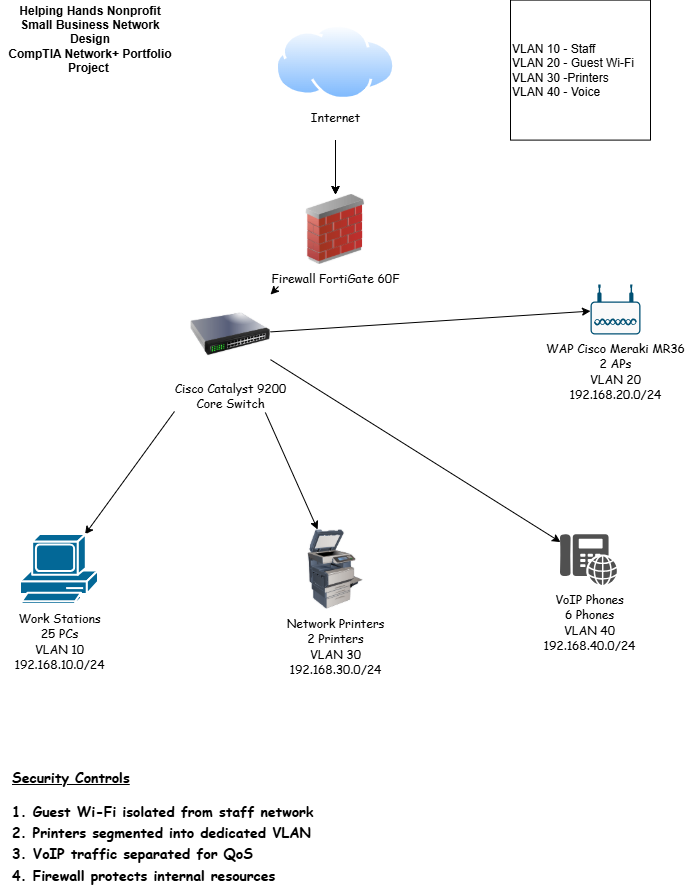

# Small Business Network Design

## Overview

This project demonstrates the design of a small business network for a fictional nonprofit organization called Helping Hands.

## Business Requirements

- 25 Staff Members
- 2 Wireless Access Points
- 2 Network Printers
- 6 VoIP Phones
- Guest Wireless Access

## Network Devices

- FortiGate 60F Firewall
- Cisco Catalyst 9200 Switch
- Cisco Meraki MR36 Access Points

## VLAN Design

| VLAN | Purpose | Network |
|------|---------|---------|
| 10 | Staff | 192.168.10.0/24 |
| 20 | Guest Wi-Fi | 192.168.20.0/24 |
| 30 | Printers | 192.168.30.0/24 |
| 40 | Voice | 192.168.40.0/24 |

## Security Controls

- Guest Wi-Fi isolated from Staff network
- Separate Printer VLAN
- Separate Voice VLAN
- Perimeter firewall protection

## Network Diagram

## Network Architecture

Internet traffic enters through a FortiGate 60F firewall and connects to a Cisco Catalyst 9200 core switch. The switch provides connectivity to staff workstations, wireless access points, network printers, and VoIP phones. Network traffic is segmented using VLANs to improve security and network performance.

## Skills Demonstrated

- Network Design
- VLAN Segmentation
- IP Addressing
- TCP/IP Concepts
- Wireless Networking
- Network Documentation

## Lessons Learned

While creating this project, I gained experience with:

- Designing a small business network
- Creating VLAN-based network segmentation
- Allocating private IPv4 address space
- Documenting network infrastructure
- Using GitHub for technical portfolio projects

## Future Improvements

Planned enhancements include:

- DHCP scope design
- Switch port assignments
- Inter-VLAN routing
- Access Control Lists (ACLs)
- Firewall rule documentation
- Network monitoring strategy  
